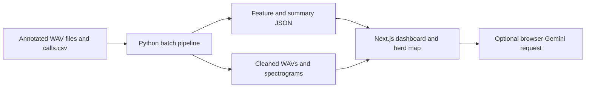

# Elecom

**Winner, Best Use of Gemini API — HackSMU VII.**

Elecom is a bioacoustics prototype for inspecting elephant vocalizations in noisy recordings. A Python pipeline enhances low-frequency rumbles and extracts acoustic features; a Next.js dashboard connects those outputs to spectrograms, cleaned audio, and optional Gemini interpretation.

## Problem and features

Environmental noise makes low-frequency calls difficult to inspect. Elecom provides an exploratory workflow for comparing raw and enhanced recordings rather than claiming to translate elephant communication.

- Adaptive filtering, spectral subtraction, Wiener postfiltering, and harmonic masking.
- Fundamental-frequency estimation, harmonic retention, and cleanability summaries.
- Research dashboard at `/`: filters, call metadata, batch results, and before/after inspection.
- Herd map at `/map`: a visual entry point into the same call records.
- User-triggered Gemini text and multimodal spectrogram interpretation.

## Architecture and stack



The frontend imports [features.json](backend/elecom/output/features/features.json) and [summary.json](backend/elecom/output/features/summary.json) directly. It serves checked-in [audio](public/audio) and [spectrograms](public/spectrograms); no running Python API is required for the dashboard.

| Layer | Implementation |
| --- | --- |
| Pipeline | Python, NumPy, SciPy, librosa, pandas, SoundFile, Matplotlib, noisereduce |
| Enhancement | [noise reduction](backend/elecom/steps/noise_reduction.py), [masking](backend/elecom/steps/masking.py), [reconstruction](backend/elecom/steps/reconstruction.py) |
| Features | [acoustic feature extraction](backend/elecom/steps/features.py), [spectrograms](backend/elecom/steps/spectrogram.py) |
| UI | Next.js 16, React, TypeScript, Tailwind CSS |
| Interpretation | [Gemini adapter](lib/gemini.ts), browser-side Google Generative AI SDK |

## Getting started

Use Node.js 22 LTS and npm. Run from the repository root:

```bash
git clone https://github.com/Advaith-1506/elecom-uc.git
cd elecom-uc
npm ci
npm run dev
```

Open [the dashboard](http://localhost:3000) or [the herd map](http://localhost:3000/map). Generated assets are already committed; pipeline regeneration is optional. This is a large repository because it includes source audio and derived research artifacts.

### Optional Gemini interpretation

The current implementation reads `NEXT_PUBLIC_GEMINI_API_KEY` from `.env.local`. **That variable is embedded in browser code and is visible to visitors.** Leave it unset for a credential-free inspection of the dataset. For local experiments only, use a restricted disposable key; restart the dev server after setting it. Move model requests behind a server endpoint before enabling a key on a shared deployment. Do not commit credentials.

### Optional pipeline regeneration

Use a separate Python environment. The entry point uses relative dataset paths, so run it from `backend/elecom`:

```bash
python3 -m venv .venv
source .venv/bin/activate
python -m pip install -r backend/elecom/requirements.txt
# Required by steps/noise_reduction.py but absent from the requirements file:
python -m pip install noisereduce
cd backend/elecom
python main.py
```

This writes to `output/`, including audio, plots, features, and summaries. Preserve existing research outputs before running it. The optional CNN fallback in [cv_analyzer.py](backend/elecom/steps/cv_analyzer.py) imports PyTorch/torchvision and can download pretrained ResNet weights; those dependencies are not in the manifest. If that path fails, the pipeline catches the error and reverts to harmonic masking. Regeneration has not been verified in a clean environment.

## Checks and demo

There is no automated test suite or `npm test` script in this snapshot. Available frontend commands are:

```bash
npm run build
npx tsc --noEmit
```

Run the TypeScript check separately: [next.config.mjs](next.config.mjs) allows builds to ignore TypeScript errors. `npm run lint` is declared, but ESLint is absent from the dependency manifest and there is no checked-in ESLint configuration.

Manual walkthrough:

1. Open `/map`, select a call, and inspect its field-station panel.
2. Compare raw and cleaned spectrograms and play a cleaned audio clip.
3. Open `/` and inspect the same selection in the batch table and feature panels.
4. If configured locally, trigger Gemini and compare its interpretation with the underlying features.

A real generated analysis image is available in [the spectrogram artifacts](public/spectrograms). It is an analysis output, not a UI screenshot. No working hosted demo is linked; the previously listed deployment returned 404 during the portfolio audit.

## Author and contributions

Maintained in [Advaith Madala's portfolio](https://github.com/Advaith-1506). Review the [commit history](https://github.com/Advaith-1506/elecom-uc/commits/main/) for individual attribution. The pipeline and UI paths above provide entry points for reviewing the engineering work. The frontend began as a v0 scaffold.

## Limitations and next steps

- The batch targets 15 annotated selections, not a representative validation dataset.
- [display-summary.ts](lib/display-summary.ts) overlays hardcoded evaluation values on the imported summary. Displayed metrics are not all calculated from the currently imported records; consult [the evaluation report](backend/elecom/output/evaluation/adaptive_pipeline_report.md) and raw JSON before citing results.
- Gemini responses are exploratory interpretations, not validated behavioral labels or biological findings.
- A reproducible dependency environment, automated signal-processing tests, consistent artifact provenance, and server-side key handling are priorities.
- No repository license is present. Dataset, model, and media rights need separate review before redistribution.

See [CONTRIBUTING.md](CONTRIBUTING.md) for contribution guidance.
